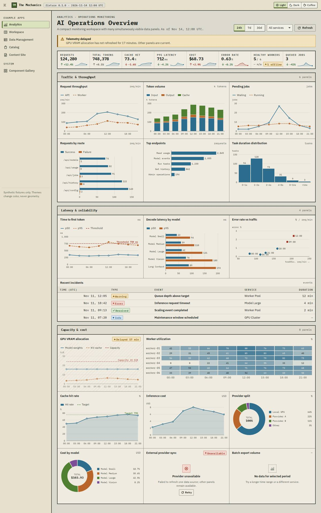
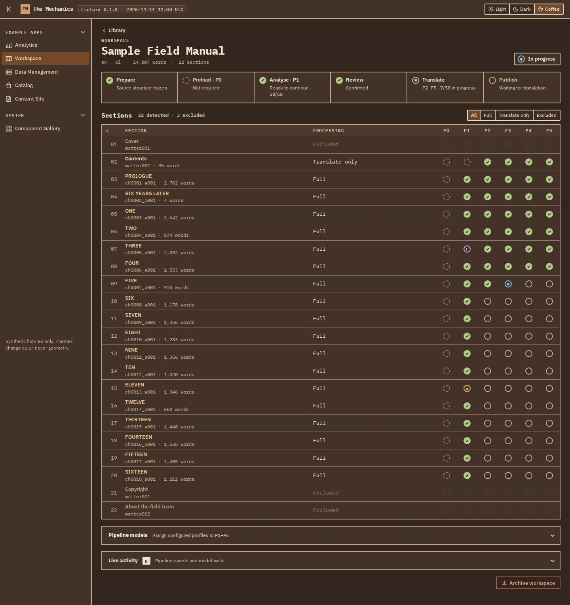
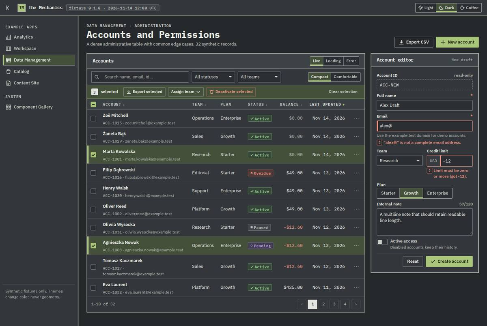
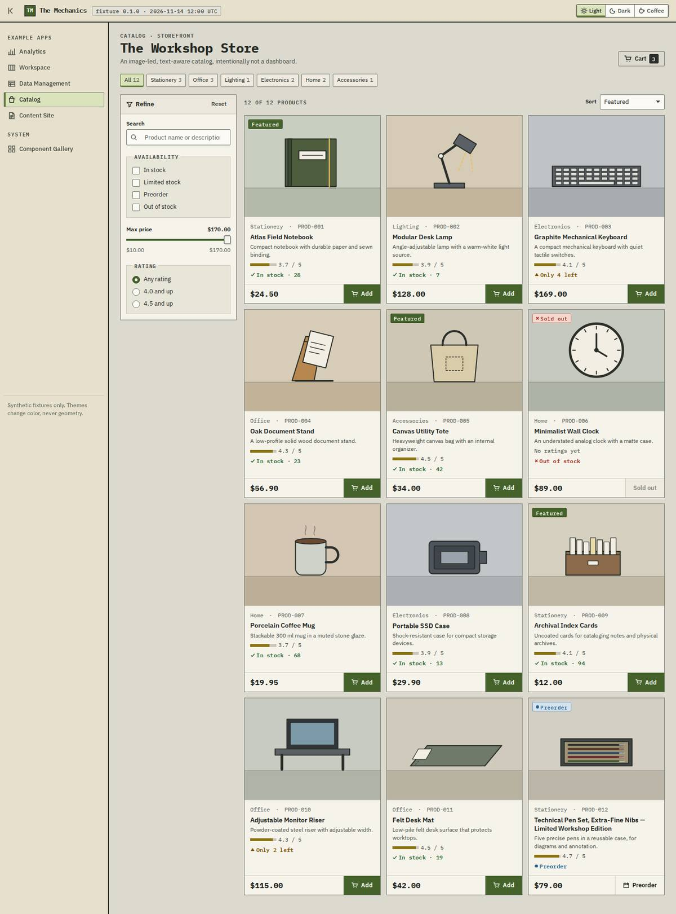

# The Mechanics

A standalone **design system and visual playground** in the *Sharp Retro-Tech / Structured Technical Minimalism* direction: one visual grammar, three themes, five very different example applications and a complete component gallery — all driven by deterministic synthetic fixtures.



| | | |
|---|---|---|
|  |  |  |
| Workspace · Coffee | Data Management · Dark | Catalog · Light |

## Install in another project (no clone)

Each [GitHub release](https://github.com/hipotures/the-mechanics/releases) ships the compiled CSS + fonts and the agent skill as zips with `SHA256SUMS`. The installer downloads them, verifies the checksums and copies them into the project you run it from (needs `curl` or `wget`, `unzip`, `sha256sum`/`shasum`; no Node.js):

```sh
cd <your-project>
curl -fsSL https://github.com/hipotures/the-mechanics/releases/latest/download/install.sh | sh
# → vendor/the-mechanics/            CSS, fonts, licenses, distribution.md
# → .claude/skills/the-mechanics/    Claude Code skill
```

Options: `--version v0.1.6` (pin a release; default latest), `--css <dir>` (e.g. `public/vendor/the-mechanics` so your server serves it), `--skill <dir>` or `--global-skill` (`~/.claude/skills/`), `--no-css`, `--no-skill`, `--force`. Re-running updates: it replaces only directories the installer created (they contain `.the-mechanics-version`) and prints a report meant to be pasted to the agent working on the app: old → new version, every changed/added/removed file (files that differ only in the version stamp are counted separately), the release notes of every skipped release and a closing instruction for the agent. Release notes: [docs/releases/](docs/releases/). Then follow [docs/distribution.md](docs/distribution.md) to load the CSS for your framework.

Skill only, with the [`skills` CLI](https://skills.sh) (installs into Claude Code and other agents; finds `skills/the-mechanics/` in this repo):

```sh
npx skills add hipotures/the-mechanics          # or: corepack pnpm dlx skills add hipotures/the-mechanics
```

Manual alternative: download the two zips from the release page and unzip them into the same places.

## Quick start (this repository)

Requires Node.js ≥ 22 with `corepack` (no global npm needed).

```sh
corepack pnpm install          # pinned dependencies (pnpm 10.34.9 via packageManager)
corepack pnpm dev              # playground at http://localhost:5173
corepack pnpm build            # dist/the-mechanics/ (portable CSS) + dist/playground/ (static site)
corepack pnpm preview          # serve the built playground at http://localhost:4173
corepack pnpm build:css        # only the portable CSS distribution
```

Verification (after `build`):

```sh
corepack pnpm exec playwright install --only-shell chromium   # once; see “Disk-backed temp” below
corepack pnpm check:contrast   # WCAG ratios: token pairs + derived colors → docs/verification/contrast*.md
corepack pnpm smoke            # 26 interaction/keyboard checks + state screenshots (own port 4175)
corepack pnpm shots [label]    # 7 views × 3 themes × desktop/mobile → tmp/screenshots/<label>/
```

**Disk-backed temp (this VM):** `/tmp` is RAM-backed. Before installing browsers or running Playwright, export project-local paths, e.g. `TMPDIR=$PWD/tmp/work XDG_CACHE_HOME=$PWD/.cache PLAYWRIGHT_BROWSERS_PATH=$PWD/.cache/ms-playwright COREPACK_HOME=$PWD/.cache/corepack`. See `AGENTS.md`.

### Pinned tool versions

| Tool | Version | License |
|---|---|---|
| Vite | 8.3.8 | MIT |
| Tailwind CSS + @tailwindcss/vite | 4.3.5 | MIT |
| daisyUI | 5.8.1 | MIT |
| Apache ECharts (charts, SVG renderer) | 6.1.0 | Apache-2.0 |
| Playwright (dev, verification only) | 1.65.1 (Chromium headless shell 159) | Apache-2.0 |
| @fontsource/ibm-plex-sans, ibm-plex-mono | 5.3.0 (IBM Plex fonts) | SIL OFL 1.1 |

## Navigating the playground

Hash routes, with the theme in the query string (instant switching, persisted in `localStorage`, testable selector `[data-testid="theme-switcher"]`):

| Route | Destination |
|---|---|
| `#/analytics` | **Analytics** — AI operations monitoring: 8 KPIs with sparklines, 16 chart/data panels in 3 regions, stale/error/empty panels, time range, service filter, legend toggles, keyboard tooltips |
| `#/workspace` | **Workspace** — pipeline overview (stage strip, sections × P0–P5 pass matrix, filter, collapsible models/activity) and `#/workspace/analyse` (unit list with P1 pass cells, block preview with EN/PL annotations, load-next, collapsible terms/costs, danger zone) |
| `#/data` | **Data Management** — searchable/sortable/paginated accounts table, selection + bulk actions, filter chips, inline rename, editor form with validation, loading/error/empty states, confirmation dialog |
| `#/catalog` | **Catalog / Commerce** — image-led product grid, category chips, filters, sort, product drawer (with missing-image view), cart with discount error |
| `#/content` | **Content Site** — editorial landing/doc page: hero, scroll-spy TOC, long-form prose, quote, figure, callout, table, code, FAQ, CTA |
| `#/components` | **Component Gallery** — every primitive in default/hover/focus/active/disabled/error/loading/empty states, the P1 components (verification code, multi-select, command palette on Ctrl/⌘+K, non-modal sheet), plus a daisyUI bridge section |

Examples: `/?theme=dark#/analytics`, `/?theme=coffee#/workspace`.

## Repository layout

```
src/the-mechanics/        PORTABLE design system (no Tailwind/daisyUI needed)
  tokens.css              theme-independent tokens (type, spacing, geometry, layout, motion)
  themes.css              light / dark / coffee color roles
  base.css                opt-in base styles scoped to .tm-root
  components.css          public .tm-* component classes
  adapters/daisyui.css    optional daisyUI 5 variable bridge
  adapters/echarts.js     optional Apache ECharts theme built from --tm-* tokens
  index.css               layered entry point
src/playground/           playground only: shell, router, pages, ECharts chart mapping, page layouts (pg-*)
fixtures/demo-data.json   deterministic synthetic data (single source of demo content)
public/products/          original generated product illustrations (scripts/gen-product-images.mjs)
examples/plain-html/      CSS-only consumer example
scripts/                  build-css, contrast, contrast-derived, screenshots, smoke, image generator;
                          install.sh (release installer, also attached to each release),
                          release-assets.sh (builds the release zips + SHA256SUMS)
skills/the-mechanics/     agent skill for applying the system in other projects;
                          scripts/audit.mjs (source) and scripts/ui-audit.mjs (rendered page, all themes)
docs/                     coverage contract, component status, distribution, derived data, verification, screenshots
references/               visual concept reference (not production code)
```

## Documentation

- [DESIGN.md](DESIGN.md) — visual intent, hierarchy, tokens, themes, component rules, chart grammar, permitted variations, anti-patterns, decisions for review.
- [docs/distribution.md](docs/distribution.md) — CSS-only integration for plain HTML, React, Svelte, Rust/Datastar, and optional Tailwind/daisyUI.
- [docs/component-status.md](docs/component-status.md) — P0/P1 status against [docs/component-coverage.md](docs/component-coverage.md).
- [docs/derived-data.md](docs/derived-data.md) — how fixtures are used and every derived value.
- [docs/verification/testing-report.md](docs/verification/testing-report.md) — what was tested, improvement passes, what was not tested.
- Screenshots: [docs/screenshots/apps/](docs/screenshots/apps/) (all 42 view × theme × viewport captures) and [docs/screenshots/states/](docs/screenshots/states/).

## Agent skill for other projects

`skills/the-mechanics/` is a Claude Code skill that teaches an agent working in *another* project how to apply this design system: wiring the CSS, the owner-approved rules that are not visible in the CSS (structure rule, item grammar, two “on” signals, focus lift, fixed-label toggles, status plates, clear buttons, layout and chart rules), copy-ready markup (`references/recipes.md`) and a heuristic audit of the app's own source (`node skills/the-mechanics/scripts/audit.mjs <dir>`). In the repository it points to `DESIGN.md` and `docs/distribution.md`; release zips bundle both into the skill's `references/`, so an install without a checkout has the full rules.

Using The Mechanics in another application is an owner decision per project. Install the skill from a release (see [Install in another project](#install-in-another-project-no-clone)), or, while developing the skill itself, link a checkout: `ln -s ~/DEV/the-mechanics/skills/the-mechanics <project>/.claude/skills/the-mechanics`.

## Provenance and licensing

- Project code and docs: CC0-1.0 (see `LICENSE`).
- All CSS, JavaScript, SVG illustrations and sample copy were written for this repository. No third-party HTML, scripts, stylesheets or design-skill packages were copied.
- Charts: Apache ECharts 6.1.0 (Apache-2.0), styled only through `src/the-mechanics/adapters/echarts.js`, which turns `--tm-*` tokens into an ECharts theme.
- Fonts: IBM Plex Sans / Mono via Fontsource, SIL Open Font License 1.1; license files are copied into `dist/the-mechanics/fonts/`.
- Visual references: the local concept `references/sharp-retro-tech-target.html` and the issue brief. The public TypeUI (Cypherpunk, Nostalgia) and Inkline Town pages are aesthetic references only and were not accessed or copied during this implementation. The daisyUI `retro`, `coffee`, `caramellatte`, `wireframe` and `cyberpunk` theme files in the installed package were inspected as starting references; the three themes here use original values.
- Fixture data is synthetic; no real customer data, credentials or book excerpts.

## Scope

This is a reviewable laboratory. It does **not** modify or migrate Intelitex, HomeStack, Gitiary or any other repository; integration requires owner approval.
